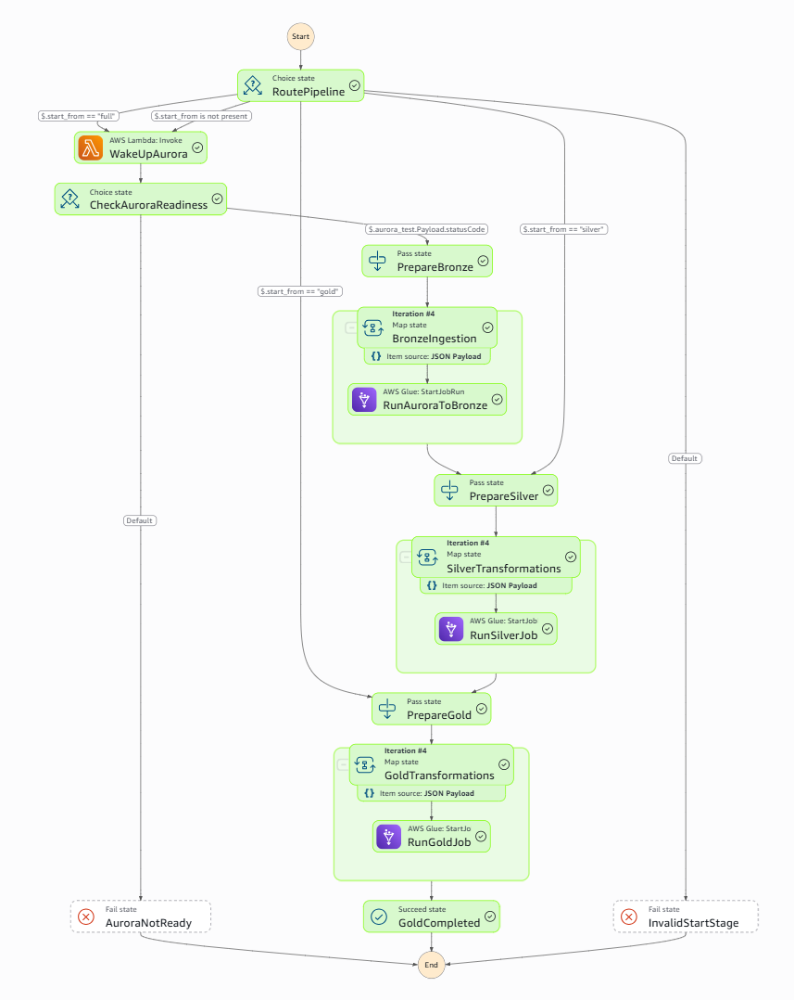

# CommerceFlow — AWS Batch Data Engineering Pipeline

**End-to-end ETL | Aurora PostgreSQL → AWS Glue → Amazon S3 (Bronze / Silver / Gold)**

CommerceFlow is a hands-on data engineering project for an e-commerce OLTP workload. It provisions infrastructure with Terraform, generates transactional data in Amazon Aurora, transforms it with PySpark on AWS Glue, orchestrates dependent stages with AWS Step Functions, and schedules the batch with Amazon EventBridge Scheduler.

**Status (November 2026):** batch pipeline deployed and executed successfully in `us-east-1`; end-to-end orchestration observed at approximately **13 minutes**. The five Gold datasets were checked with a combined **32,500 rows**. This is a **development/lab implementation**, not a production-grade platform.

- **Environment:** `dev`
- **AWS region:** `us-east-1` (N. Virginia)
- **Default naming prefix:** `commerceflow-dev`
- **Schedule tested:** daily at **20:05**, `America/Lima` (Peru time, UTC−05:00); verify current `ENABLED`/`DISABLED` status before relying on it.
- **Data processing:** full-table snapshots; **not CDC/incremental**.
- **Out of scope / not implemented:** Redshift serving layer, Kafka streaming, DynamoDB checkpoints, automated CI/CD, comprehensive production observability.

## 1. Architecture

```text
Amazon EventBridge Scheduler (20:05 America/Lima)
                     |
                     v
AWS Step Functions Standard: commerceflow-dev-batch-pipeline
  |
  +-- RoutePipeline: full | silver | gold
  |
  +-- [full] Lambda readiness check -> Aurora PostgreSQL / RDS Data API
  |        |
  |        +-- BronzeIngestion (Map, max concurrency 2)
  |              5 tables -> ONE generic AWS Glue JDBC/PySpark job
  |              Aurora -> S3 bronze/<table>/snapshot/
  |
  +-- SilverTransformations (Map, max concurrency 3)
  |        5 Glue jobs -> S3 silver/<table>/
  |                    -> S3 quarantine/<table>/ (rejected records)
  |
  +-- GoldTransformations (Map, max concurrency 3)
           5 Glue jobs -> S3 gold/dim_* and gold/fact_*

Terraform: VPC/private subnets, Aurora, Lambda, Glue, IAM, S3,
           Step Functions, EventBridge Scheduler, networking/endpoints.
CloudWatch: Glue job logs, Lambda logs, execution diagnostics.
```

Step Functions uses Glue `startJobRun.sync`, so a stage waits for its Glue tasks to finish before advancing. The Map stages parallelize tables/jobs, not arbitrary steps within a job.

> **[SCREENSHOT 01]** Step Functions execution graph showing Lambda → Bronze → Silver → Gold. Save as `docs/images/01-step-functions-execution.png`.
> <!--  -->

## 2. Data model and outputs

### Source: Aurora PostgreSQL (OLTP)

| Table | Rows in verified test dataset | Purpose |
|---|---:|---|
| `customers` | 2,000 | Customer reference data |
| `products` | 500 | Product reference data |
| `orders` | 10,000 | Order headers |
| `order_items` | 10,000 | Order line items |
| `payments` | 10,000 | Payment transactions |
| **Total** | **32,500** | Synthetic source dataset |

The schema includes primary/foreign keys, `CHECK` and `UNIQUE` constraints, `NUMERIC(12,2)`, `TIMESTAMPTZ`, and relational indexes. The synthetic generator currently produces one item and one payment per order; this is deliberate test-data simplification.

### S3 Medallion layout

```text
s3://<bucket>/
  scripts/                       # Glue scripts uploaded by Terraform
  bronze/
    customers/snapshot/
    products/snapshot/
    orders/snapshot/
    order_items/snapshot/
    payments/snapshot/
  silver/
    customers/ products/ orders/ order_items/ payments/
  quarantine/
    customers/ products/ orders/ order_items/ payments/
  gold/
    dim_customer/                # 2,000 rows
    dim_product/                 #   500 rows
    fact_orders/                 # 10,000 rows
    fact_order_items/            # 10,000 rows
    fact_payments/               # 10,000 rows
```

- **Bronze:** generic JDBC extraction; a full Parquet snapshot per table, with ingestion metadata.
- **Silver:** typed/cleaned datasets, validation, and rejected records in `quarantine/` when applicable.
- **Gold:** analytics-ready dimensions and facts. Gold is stored in S3 Parquet; **Redshift has not yet been added**.
- **Write behavior:** Spark `mode("overwrite")` replaces the target folder. It requires `s3:DeleteObject` as well as read/write permissions and is not an atomic, incremental publish.

> **[SCREENSHOT 02]** S3 bucket showing `bronze/`, `silver/`, `gold/`, and `quarantine/`. Save as `docs/images/02-s3-medallion.png`.
> <!--  -->

## 3. Repository structure

Relevant paths established during implementation:

```text
commerceflow/
├── README.md
├── sql/
│   └── schema.sql
├── lambdas/
│   └── aurora_test/
│       ├── generator.py          # CommerceDataGenerator
│       └── aurora_loader.py      # AuroraDataApiLoader
├── pipelines/
│   └── batch/
│       ├── bronze/
│       │   └── aurora_to_s3.py   # Generic source-table snapshot
│       ├── silver/              # Glue Bronze -> Silver scripts
│       └── gold/
│           └── orders_to_gold.py
├── infrastructure/
│   └── terraform/
│       └── aurora/              # Terraform root used earlier in the project
│           ├── versions.tf
│           ├── providers.tf
│           ├── variables.tf
│           ├── locals.tf
│           ├── network.tf
│           ├── aurora.tf
│           ├── lambda.tf
│           ├── s3.tf
│           ├── glue_network.tf
│           ├── glue.tf
│           ├── orders_to_gold.tf
│           ├── step_functions.tf
│           ├── eventbridge_scheduler.tf
│           └── outputs.tf
└── docs/
    └── images/                 # Add your AWS Console screenshots here
```

**Repository-specific note:** some iterations placed the Terraform root under `infrastructure/terraform/dev/` instead of `aurora/`; identify the actual directory containing `step_functions.tf`. Individual Silver/Gold scripts and Terraform files may be split differently in your checkout. The tree above describes responsibilities, **not a verified filesystem listing**. Use the checked-in `.tf` `source`/`script_location` references as the source of truth; do not rename scripts to match this illustration.

## 4. Prerequisites

1. AWS account with billing enabled and permission to provision VPC, RDS/Aurora, Secrets Manager, Lambda, S3, Glue, IAM, Step Functions, EventBridge Scheduler, and CloudWatch.
2. **AWS CLI v2**, **Terraform** (compatible with `versions.tf`), **Git**, and a shell such as Git Bash (examples below use Bash).
3. Optional for Parquet verification: **Python 3** and `uv` / `pyarrow`.
4. Use an **IAM/SSO identity with appropriate permissions**; avoid using the AWS root account for development.
5. Check account **Glue ETL capacity/quotas** before deploying; a valid IAM role alone does not resolve account-level provisioning restrictions.

```bash
aws --version
terraform version
aws configure --profile commerceflow-dev   # Or use your existing IAM/SSO profile
export AWS_PROFILE=commerceflow-dev
export AWS_REGION=us-east-1
export AWS_DEFAULT_REGION="$AWS_REGION"

aws sts get-caller-identity
export ACCOUNT_ID=$(aws sts get-caller-identity --query Account --output text)
export PREFIX=commerceflow-dev
export BUCKET="${PREFIX}-lake-${ACCOUNT_ID}-${AWS_REGION}"
printf 'Region=%s\nBucket=%s\n' "$AWS_REGION" "$BUCKET"
```

Ensure the account/region returned by `sts` match the environment you intend to deploy. The bucket name is derived from the naming convention used in this project; confirm it against `terraform output` or your `s3.tf` if you customize naming.

**Secrets:** do not commit credentials, `.tfstate`, `.terraform/`, plan files, or private `terraform.tfvars`. Do not paste passwords or payment-method details into screenshots.

## 5. Deploy from scratch

### Step 1 — Clone and inspect configuration

```bash
git clone <YOUR_REPOSITORY_URL>
cd commerceflow

# Locate the actual Terraform root; works in Git Bash.
find infrastructure/terraform -name step_functions.tf -print
export REPO_ROOT="$PWD"
export TF_DIR=$(dirname "$(find infrastructure/terraform -name step_functions.tf -print -quit)")
cd "$TF_DIR"

# Check the input variable names before preparing local tfvars.
cat variables.tf
```

Set values required by your current `variables.tf` in local `terraform.tfvars` (not committed). For the deployed naming convention, `project_name = "commerceflow"`, `environment = "dev"`, and region `us-east-1` are the intended values; use the **actual variable names in your repo** for region/account configuration. If `providers.tf` uses `allowed_account_ids`, authorize your own AWS account.

Keep the scheduler **disabled for the first deployment**, even if its eventual cron is 20:05 Peru time:

```hcl
commerceflow_schedule_expression = "cron(5 20 * * ? *)"
commerceflow_schedule_enabled    = false
```

Use these only if those variables are declared in your scheduler Terraform configuration.

### Step 2 — Initialize and provision infrastructure

```bash
terraform init
terraform fmt -check
terraform validate
terraform plan -out=tfplan
terraform show tfplan
terraform apply tfplan
terraform output
```

**Initial-bootstrap dependency:** some project versions use `data "aws_lambda_function" "aurora_readiness"` and `data "aws_iam_role"` for resources created by the **same** Terraform configuration. On an empty AWS account, Terraform may try to read those data sources before the Lambda/role exists. For a fully reproducible **single apply**, replace those lookups with direct references to their managed Terraform `resource` blocks. Otherwise, deploy the underlying Lambda/shared Glue role first, then apply orchestration. Do not blindly run a destructive `-target` or `destroy` operation.

Check that Terraform creates or manages:

- Private VPC, two private subnets, DB subnet group and security groups.
- Aurora PostgreSQL Serverless v2 and its managed secret.
- S3 bucket plus encrypted/private data-lake configuration.
- Lambda for RDS Data API / setup / readiness.
- Glue JDBC connection, shared role, scripts and jobs.
- Step Functions state machine and scheduler role/schedule.

> **[SCREENSHOT 03]** Terraform successful apply and/or AWS RDS cluster `commerceflow-dev` (`available`). Save as `docs/images/03-terraform-aurora.png`.
> <!--  -->

### Step 3 — Verify AWS network and Aurora

The tested network uses VPC CIDR `10.20.0.0/16`, private subnets `10.20.1.0/24` and `10.20.2.0/24`, Aurora port `5432`, an S3 Gateway Endpoint and Secrets Manager Interface Endpoint. Aurora is **not publicly accessible**.

Aurora configuration in this lab:

- Cluster `commerceflow-dev`, writer `commerceflow-dev-writer`, database `commerceflow`.
- Aurora PostgreSQL Serverless v2, version **16.15** in the original tested configuration.
- `0–2` ACUs, auto-pause after `300 s` when eligible; Data API enabled.
- Managed master password via Secrets Manager; do not store it in Terraform.
- **Lab-only:** 1-day backup retention, deletion protection disabled, no final snapshot.

```bash
aws rds describe-db-clusters \
  --db-cluster-identifier "$PREFIX" \
  --region "$AWS_REGION" \
  --query 'DBClusters[0].{Status:Status,Engine:Engine,Version:EngineVersion,Endpoint:Endpoint,DataAPI:HttpEndpointEnabled}' \
  --output table

aws lambda invoke \
  --function-name "${PREFIX}-aurora-test" \
  --cli-binary-format raw-in-base64-out \
  --payload '{"action":"test"}' \
  /tmp/commerceflow-test.json >/dev/null
cat /tmp/commerceflow-test.json
# Expected application response: {"statusCode":200,"result":1}
```

The readiness Lambda uses RDS Data API `SELECT 1`. After Aurora auto-pauses, it may require time to resume. Do not assume a valid Data API test guarantees that a JDBC connection can never time out.

### Step 4 — Create and seed the OLTP dataset

Schema SQL: `sql/schema.sql`. Lambda actions used during development: `create_schema`, `verify_schema`, `seed_reference`, and `seed_orders`.

```bash
for ACTION in create_schema verify_schema seed_reference seed_orders; do
  aws lambda invoke \
    --function-name "${PREFIX}-aurora-test" \
    --cli-binary-format raw-in-base64-out \
    --payload "{\"action\":\"${ACTION}\"}" \
    "/tmp/commerceflow-${ACTION}.json" >/dev/null
  echo "$ACTION:"
  cat "/tmp/commerceflow-${ACTION}.json"
  echo
done
```

**Seed semantics:** the original project populated orders in batches (first 100 orders, then additional batches). **One `seed_orders` invocation does not necessarily create 10,000 orders.** Follow the checked-in Lambda handler's supported batch/offset parameters and repeat as required; validate counts after seeding. `ON CONFLICT DO NOTHING` supports re-runs for matching keys but is **not CDC**.

Verify counts through RDS Data API without connecting directly to the private PostgreSQL endpoint:

```bash
export CLUSTER_ARN=$(aws rds describe-db-clusters \
  --db-cluster-identifier "$PREFIX" \
  --query 'DBClusters[0].DBClusterArn' --output text)

export SECRET_ARN=$(aws rds describe-db-clusters \
  --db-cluster-identifier "$PREFIX" \
  --query 'DBClusters[0].MasterUserSecret.SecretArn' --output text)

for TABLE in customers products orders order_items payments; do
  COUNT=$(aws rds-data execute-statement \
    --resource-arn "$CLUSTER_ARN" \
    --secret-arn "$SECRET_ARN" \
    --database commerceflow \
    --sql "SELECT COUNT(*) FROM ${TABLE}" \
    --query 'records[0][0].longValue' --output text)
  printf '%-14s %s\n' "$TABLE" "$COUNT"
done
```

If counts differ from the sample dataset, Gold counts should be validated against **your actual source**, not the sample numbers above.

> **[SCREENSHOT 04]** Aurora tables and verified row counts (SQL/Data API), without secrets. Save as `docs/images/04-aurora-table-counts.png`.
> <!--  -->

### Step 5 — Verify Glue jobs and IAM

One generic `aurora-to-bronze` job reads all five tables using `--SOURCE_TABLE`. There are **five Bronze → Silver jobs** and **five Silver → Gold jobs**; each job uses the shared role `AWSGlueServiceRole-commerceflow-dev`.

```bash
aws glue get-job \
  --job-name "${PREFIX}-aurora-to-bronze" \
  --query 'Job.{Name:Name,Role:Role,GlueVersion:GlueVersion,WorkerType:WorkerType,Workers:NumberOfWorkers}' \
  --output table

for ENTITY in customers products orders order-items payments; do
  aws glue get-job --job-name "${PREFIX}-${ENTITY}-to-silver" \
    --query 'Job.Name' --output text
  aws glue get-job --job-name "${PREFIX}-${ENTITY}-to-gold" \
    --query 'Job.Name' --output text
done
```

Expected Spark configuration in the tested jobs: Glue `5.1`, `2 × G.1X` workers; `max_retries = 0` on the jobs described during implementation. The Bronze stage is parameterized by source table; it is **not** five separate Bronze job definitions.

**IAM / network requirements:**

- Glue: S3 list/read/write; `s3:DeleteObject` under **`bronze/*`, `silver/*`, `gold/*`, `quarantine/*`** for overwrite; read the Aurora secret; JDBC network access to Aurora on `5432`.
- Step Functions: invoke readiness Lambda, start and inspect the authorized Glue jobs for `.sync` integration.
- Scheduler: `states:StartExecution` on the specific state machine ARN.
- Lambda: RDS Data API, Secrets Manager and CloudWatch Logs as required.
- Glue security group: worker-to-worker connectivity plus routing/endpoints for S3 and Secrets Manager.

To verify the original overwrite fix:

```bash
aws iam simulate-principal-policy \
  --policy-source-arn "arn:aws:iam::${ACCOUNT_ID}:role/AWSGlueServiceRole-${PREFIX}" \
  --action-names s3:DeleteObject \
  --resource-arns "arn:aws:s3:::${BUCKET}/quarantine/orders/test.parquet" \
  --query 'EvaluationResults[].{Action:EvalActionName,Decision:EvalDecision}' \
  --output table
# Expect: allowed (identity policy simulation; still check SCPs/bucket policies).
```

> **[SCREENSHOT 05]** Glue Jobs showing the Bronze job and successful Silver/Gold runs. Save as `docs/images/05-glue-job-runs.png`.
> <!--  -->

### Step 6 — Run the complete pipeline manually

Find the **state machine ARN** (not an execution ARN):

```bash
export STATE_MACHINE_ARN=$(aws stepfunctions list-state-machines \
  --query "stateMachines[?name=='${PREFIX}-batch-pipeline'].stateMachineArn | [0]" \
  --output text)

echo "$STATE_MACHINE_ARN"
```

Start a full execution:

```bash
export EXECUTION_ARN=$(aws stepfunctions start-execution \
  --state-machine-arn "$STATE_MACHINE_ARN" \
  --name "manual-$(date +%Y%m%d%H%M%S)" \
  --input '{"start_from":"full"}' \
  --query 'executionArn' --output text)

echo "$EXECUTION_ARN"
```

Inspect the result **using the execution ARN**, not the state machine ARN:

```bash
aws stepfunctions describe-execution \
  --execution-arn "$EXECUTION_ARN" \
  --query '{Status:status,Started:startDate,Stopped:stopDate,Error:error,Cause:cause}' \
  --output json
```

Supported inputs:

| Input | What executes |
|---|---|
| `{"start_from":"full"}` or `{}` | Aurora readiness → Bronze → Silver → Gold |
| `{"start_from":"silver"}` | Silver → Gold; skips Aurora/Bronze |
| `{"start_from":"gold"}` | Gold only; reads existing Silver data |

The selective inputs are useful for tests, but **do not** regenerate missing upstream files. Never run two overlapping full snapshots without first handling concurrency and overwrite collisions.

### Step 7 — Verify output files and row counts

```bash
for TABLE in customers products orders order_items payments; do
  echo "--- bronze/${TABLE}/snapshot/ ---"
  aws s3 ls "s3://${BUCKET}/bronze/${TABLE}/snapshot/" --recursive
  echo "--- silver/${TABLE}/ ---"
  aws s3 ls "s3://${BUCKET}/silver/${TABLE}/" --recursive
done

for DATASET in dim_customer dim_product fact_orders fact_order_items fact_payments; do
  echo "--- gold/${DATASET}/ ---"
  aws s3 ls "s3://${BUCKET}/gold/${DATASET}/" --recursive
done
```

**S3 file presence does not prove content correctness.** To count actual Parquet rows using Python + PyArrow in Git Bash, run from a location with `uv` installed:

```bash
uv run --with pyarrow python - <<'PY'
import os
import pyarrow.dataset as ds
import pyarrow.fs as fs

bucket = os.environ["BUCKET"]
region = os.environ.get("AWS_REGION", "us-east-1")
s3 = fs.S3FileSystem(region=region)

for name in ["dim_customer", "dim_product", "fact_orders", "fact_order_items", "fact_payments"]:
    path = f"{bucket}/gold/{name}"
    rows = ds.dataset(path, filesystem=s3, format="parquet").count_rows()
    print(f"{name:20} {rows:>8,}")
PY
```

Expected for the original synthetic dataset: `2,000 + 500 + 10,000 + 10,000 + 10,000 = 32,500` Gold rows. Also check column types, nulls/invalid data, and quarantine counts where applicable.

> **[SCREENSHOT 06]** S3 Gold Parquet objects and/or terminal with five verified row counts. Save as `docs/images/06-gold-validation.png`.
> <!--  -->

### Step 8 — Enable daily scheduling (after validation)

Configured expression for **8:05 p.m. Peru time every day**:

```hcl
schedule_expression          = "cron(5 20 * * ? *)"
schedule_expression_timezone = "America/Lima"
```

If your Terraform uses the project scheduler variables, configure and re-apply:

```hcl
commerceflow_schedule_expression = "cron(5 20 * * ? *)"
commerceflow_schedule_enabled    = true
```

```bash
terraform plan
terraform apply

aws scheduler get-schedule \
  --name "${PREFIX}-daily-schedule" \
  --region "$AWS_REGION" \
  --query '{State:State,Cron:ScheduleExpression,Timezone:ScheduleExpressionTimezone,Target:Target.Arn}' \
  --output table
```

Expected: `ENABLED`, `cron(5 20 * * ? *)`, `America/Lima`, target pointing to the **Step Functions state machine**. The AWS resource is hosted in `us-east-1`, but the cron is evaluated in Peru local time. Scheduler sends `{"start_from":"full"}`. It has an independent IAM role that may only start that state machine.

**Operation:** disable the scheduler when the project is not in use; the current implementation does not implement cross-execution locking. EventBridge can deliver an invocation more than once, so downstream writes must not assume exactly-once scheduling.

> **[SCREENSHOT 07]** EventBridge Scheduler details with cron, timezone, status and target. Save as `docs/images/07-eventbridge-scheduler.png`.
> <!--  -->

## 6. Troubleshooting

| Symptom | Check / correction |
|---|---|
| `AccessDenied` for `s3:DeleteObject` | Spark overwrite also deletes old objects; ensure Glue role allows DeleteObject under `bronze/*`, `silver/*`, `gold/*` **and** `quarantine/*`. Re-apply IAM policy. |
| `Connection attempt timed out` in Glue | Aurora may be paused/resuming; verify readiness, Glue JDBC connection, private subnets, security group rules on `5432`, SSL and VPC endpoints. |
| `Exceeded maximum concurrent compute capacity: 0` / `CreateJob` denied | Confirm account verification and Glue capacity/service restrictions, in addition to IAM. |
| `DatabaseResumingException` | Aurora Serverless v2 is waking up; confirm its status and retry setup/readiness after it becomes ready. |
| `InvalidArn` in `describe-execution` | Pass an `executionArn` from `start-execution`, not `stateMachineArn`. |
| Data API rejects a transaction field | `commit-transaction`/`rollback-transaction` require their own parameters; do not pass `database` to those API calls. |
| RDS Data API `NUMERIC` insertion issue | Serialize decimals with the appropriate `DECIMAL` type hint. |
| Gold outputs don't match expected count | Confirm source row counts and input snapshots; inspect Glue logs, Silver quarantine and job status. |

Useful diagnostics:

```bash
aws glue get-job-runs \
  --job-name "${PREFIX}-aurora-to-bronze" \
  --max-results 10 \
  --query 'JobRuns[].{Id:Id,State:JobRunState,Seconds:ExecutionTime,DPUSeconds:DPUSeconds,Error:ErrorMessage}' \
  --output table

aws logs describe-log-groups --log-group-name-prefix /aws-glue/jobs --region "$AWS_REGION"
aws stepfunctions list-executions \
  --state-machine-arn "$STATE_MACHINE_ARN" \
  --max-results 10 \
  --query 'executions[].{Status:status,Started:startDate,ARN:executionArn}' \
  --output table
```

## 7. Costs and operational safeguards

- **13 minutes** is Step Functions *wall-clock* duration, **not** cumulative Glue compute time. Parallel Glue jobs are billed separately.
- Glue job configuration observed: 2 `G.1X` workers per job (2 DPUs). Estimate Spark compute from each run's `DPUSeconds / 3600 × regional DPU-hour price`, summed across all jobs.
- Step Functions Standard bills state transitions; EventBridge Scheduler, S3 and CloudWatch have their own usage metrics.
- Aurora Serverless v2 may pause at 0 ACU, but storage, Secrets Manager and **Secrets Manager Interface VPC Endpoint** can incur charges even when jobs are idle.
- The AWS Billing screenshot on **November 6, 2026** showed **US$3.62 estimated month-to-date across the account**; this is **not** the cost of one CommerceFlow execution.
- Monitor [AWS Bills](https://console.aws.amazon.com/billing/home#/bills) and [Cost Explorer](https://console.aws.amazon.com/costmanagement/home#/cost-explorer). Configure a budget alert before leaving the schedule enabled.
- Keep `force_destroy = false` for the data-lake bucket. **Do not run `terraform destroy` casually**: the same state manages Aurora, its database and S3 data.
- Never expose AWS credentials, DB secrets, account-specific billing data or sensitive IDs in public screenshots.

> **[SCREENSHOT 08]** Billing → Charges by service (redact account/payment identifiers). Save as `docs/images/08-aws-costs.png`.
> <!--  -->

## 8. Scope, limitations, and next steps

**Implemented and tested:** Terraform-provisioned AWS foundation; Aurora schema and synthetic data; Glue JDBC extraction; S3 Bronze, Silver, Gold and quarantine; 15 Glue job invocations per full run (5 Bronze runs of one generic job + 5 Silver jobs + 5 Gold jobs); Step Functions orchestration and manual reruns by stage; EventBridge Scheduler; CloudWatch visibility; validated Gold Parquet row counts.

**Not yet implemented / not claimed:**

1. **Incremental/CDC loads:** watermarks, changed rows, delete handling, checkpointing and reliable replay.
2. **Atomic outputs and orchestration concurrency control:** prevent partial-overwrite exposure and overlapping scheduled snapshots.
3. **Redshift analytics layer:** load/serve Gold datasets in a warehouse.
4. **Kafka streaming / DynamoDB checkpoints:** next architectural milestones, not part of this deployed batch.
5. **CI/CD and production hardening:** GitHub Actions, automated data-quality gates, least-privilege database user, alarms, retries/error policies, secrets hygiene and a tested disaster-recovery procedure.

## 9. Screenshot checklist

Create `docs/images/`, capture the following from **your own AWS Console**, and replace the `[SCREENSHOT]` notes above with the corresponding Markdown image references:

1. `01-step-functions-execution.png` — successful Step Functions graph.
2. `02-s3-medallion.png` — S3 prefix structure.
3. `03-terraform-aurora.png` — infrastructure deployment / RDS cluster.
4. `04-aurora-table-counts.png` — source table counts.
5. `05-glue-job-runs.png` — successful Glue jobs.
6. `06-gold-validation.png` — Gold objects and verified record counts.
7. `07-eventbridge-scheduler.png` — daily 20:05, `America/Lima`.
8. `08-aws-costs.png` — cost by service, redacted.

Example insertion after saving an image:

```markdown

```

---

**Project principle:** infrastructure as code, reproducible validation, explicit cost boundaries, and honest separation between what has been deployed and what is planned.
